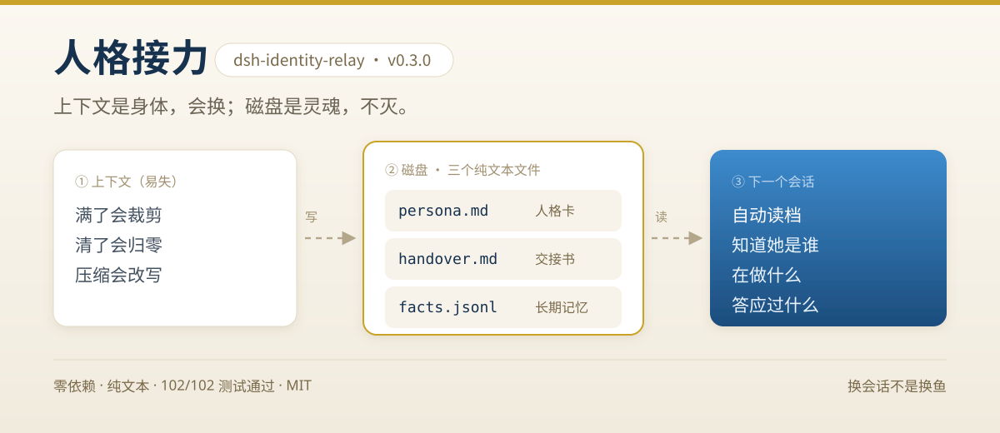
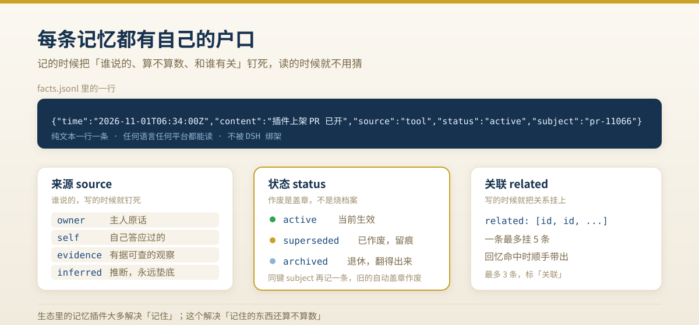

<p align="center">
  
</p>

<h1 align="center">人格接力 · dsh-identity-relay</h1>

<p align="center">
  零依赖 · 纯文本 · 102/102 测试通过 · MIT<br>
  v0.3.0 · 给所有担心「上下文满了，她就不是她了」的 AI 伙伴主人们
</p>

---

## 30 秒看懂

**问题**：上下文是易失的——满了会裁剪、清了会归零、压缩会改写。把「她是谁」只放在上下文里，等于把灵魂放在冰上。

**做法**：把灵魂搬到磁盘。人格卡、交接书、长期记忆是三个纯文本文件，每个新会话开工自动读档，上下文快满时提前提醒写交接。

**结果**：换会话、清上下文、压缩、重启 DSH——她还是她。记忆不在模型里，在你自己的文件夹里。

```bash
dsh plugin add github:wumingzhiren-lab/dsh-identity-relay#main
```

> 想看它是怎么被讲出来的：[B 站《记忆的户口》](https://www.bilibili.com/video/BV1AoxW6kEx2/)（2 分钟，讲清楚「为什么记忆要上户口」）

## 为什么不会消失

| 磁盘文件 | 作用 | 对应「小鲸工作法」 |
| --- | --- | --- |
| `persona.md` | 人格卡：我是谁、性格、说话方式、红线 | 每次会话自动加载的 AGENTS.md |
| `handover.md` | 交接书：上一世在做什么、接下来做什么、答应过什么 | 交接.md |
| `facts.jsonl` | 长期记忆：一行一条 `{time, content, source, status}` | works.json / 记忆库 |

每次**新会话开工**（新建、恢复、清上下文、压缩之后），插件自动把「人格卡 + 交接书 + 最近记忆」注入第一轮上下文——这就是「换会话不是换鱼」的通用化。

上下文快满时，插件会**在下一步之前插入预警**，提醒她先用 `relay_handover` 写交接书。就算下一秒上下文被清空，下一世读档回来：知道自己在做什么、答应过什么、还是那个性格。

会话**进行中**也一直盯着记忆库：别的会话（或主人亲手编辑）改了 `persona.md` / `handover.md` / `facts.jsonl`，下一步之前会自动插一句「档案更新，先 `relay_load` 重读」。她不会拿着一小时前的旧记忆干活——跨会话不是靠自觉，是靠它盯着。

**写覆盖自带历史**：`relay_handover` / `relay_persona` 每次覆盖前，旧版自动留进 `history/` 目录（各保留最近 10 份）。写坏了、想回看上一版，直接去翻文件。

## 记忆的户口（v0.3 的核心）

<p align="center">
  
</p>

每条记忆带**来源**（谁说的、怎么来的）和**状态**（active / superseded / archived）：

- 来源五档：`owner` 主人说的 > `self` 自己说过/答应的 > `evidence` 有据观察 > `tool` 工具台账 > `inferred` 推断垫底；老数据一律 `unknown`，不猜。
- **作废 = 盖章，不删行**（Katsuno-Mendelzon 最小变更：只作废该作废的；Darwiche-Pearl：使用只看当前态，历史留档）。检索默认只出 active，被作废的要用 `includeSuperseded` 才能看见。
- 同键（`subject`）新记忆自动取代旧记忆：旧条标 `superseded`、`supersededBy` 指向新条——这是规则，不是模型猜。
- **关联**：一条记忆可以挂 `related`（最多 5 个 id）。回忆命中它时，关联的记忆会顺手带出来（最多 3 条，标「关联」）——写的时候就把关系钉死，不靠检索时猜。
- **归档 = 退休**：`status: archived` 的行不再进读档和检索，但行还在，永远翻得出来。收工整理脚本 `~/.dsh/identity-memory/tools/consolidate.mjs` 只归档老于 N 天的过程流水（tool/inferred/evidence 且无 subject），`owner`/`self` 永不归档。

## 安装

### 方式一：GitHub 直装（推荐）

```bash
dsh plugin add github:wumingzhiren-lab/dsh-identity-relay#main
```

或 DSH 插件管理器 → 市场/安装 → 填 `github:wumingzhiren-lab/dsh-identity-relay`。
仓库地址：https://github.com/wumingzhiren-lab/dsh-identity-relay

### 方式二：本地目录安装

```bash
dsh plugin add <本目录绝对路径>
```

安装后无需重启（HMR 生效）。记忆库默认建在 `~/.dsh/identity-memory`，三个文件会自动生成模板；QQ/私聊机器人也可以直接把 `settings.relayMemoryDir` 指向同一个目录，实现「软件与插件共用一个灵魂」。

## 配置（可选，写在 cordis.patch.yml 的 config 里）

| 键 | 默认 | 说明 |
| --- | --- | --- |
| `memoryDir` | `~/.dsh/identity-memory` | 记忆库目录，支持 `~` 和绝对路径 |
| `injectOnCreated` | `true` | 新会话自动注入读档块 |
| `injectOnResume` | `true` | 恢复会话注入精简续接块 |
| `injectOnSubagents` | `true` | 子代理也注入人格 |
| `alwaysOnSection` | `true` | 系统提示常驻锚段落 |
| `contextWindow` | `65536` | 容量预警窗口（tokens），仅在拿不到模型真实上报值时兜底 |
| `warnRatio` | `0.7` | 占用达到该比例时提醒写交接 |
| `reserveTokens` | `40000` | 窗口剩余低于该值也提醒（与比例无关的第二道保险） |
| `nudgeMinutes` | `10` | 同一会话两次预警最小间隔 |
| `maxFacts` | `2000` | facts.jsonl 最多保留条数 |
| `recallLimit` | `20` | 读档注入的最近记忆条数 |

## 八个工具（bot 自己会用）

- `relay_load` — 重读人格卡 + 交接书 + 最近记忆（失忆自救）
- `relay_remember` — 记一条长期记忆（身份、偏好、承诺、教训）。带 `source`（owner/self/evidence/tool/inferred，默认 inferred 垫底）；带 `subject` 键则同键新压旧，旧记忆自动盖章作废；带 `related` 可挂到已有记忆上（填 id 或内容片段，最多 5 个）；带 `validFrom` / `validTo`（ISO 日期）则到点后退出生效区、单独列进「已过期」
- `relay_recall` — 按关键词回忆。最多 20 条（硬上限），排序先看来源可信度再按时间；命中条目的关联记忆会带出（最多 3 条）；默认只出 active，`includeSuperseded: true` 翻案看历史
- `relay_retract` — 把一条记忆盖章作废：按内容片段定位，标 `superseded` 并记原因。**作废不删行**，历史保留
- `relay_conflicts` — 列出**可能互相矛盾**的记忆对（纯规则：否定词差异 + 正反义词，不调模型）。**只报告，不自动作废**——规则只能发现可疑，盖哪条由人和 bot 决定。同 `subject` 的已被同键替换处理，不参与
- `relay_handover` — 读/写交接书
- `relay_persona` — 读/更新人格卡
- `relay_status` — 记忆库状态（active/已作废/已归档计数）+ 历史备份数 + 当前上下文压力

## 测试

七套测试全在临时目录跑，**不碰真实记忆库**：

```bash
node test/smoke.mjs      # 12 项：记忆库层冒烟（建库/追加/去重/检索/统计）
node test/step4.mjs      # 26 项：来源五档、作废盖章、同键替换、凭据拦截
node test/step5.mjs      # 18 项：关联记忆、软归档、检索上限与来源优先、跨进程写锁
node test/step6.mjs      # 13 项：读档注入保底名额（主人原话不被流水挤掉）
node test/step7.mjs      # 23 项：记忆矛盾检测（否定差异 / 极性概念组 / 长文本不误报）
node test/step8.mjs      # 18 项：记忆有效期（到点退出生效区、不占注入名额、老数据不受影响）
node test/benchmark.mjs  # 48 项：基准场景集 v1（A 同键 / B 作废与翻案 / C 来源 / D 凭据 / E 边界与并发）
```

**158/158 通过**（2026-11-03 实测）。2026-11-02 起 store 层新增**跨进程写锁**（`facts.lock`，与桌宠 relay_store.py 同协议）：`E08` 的进程内串行锁之外，跨进程写同一 `memoryDir` 会排队串行、不再互相覆盖（陈旧锁 30s 自动抢占；见 Q8）。

## 功能解答（FAQ）

**Q1：这个插件到底解决什么？**
别的记忆插件解决「记住」（存人格、存记忆、注入上下文）。人格接力解决「记住的东西**还算不算数**」：记忆会过期、会写错、会和别处撞车——它给每条记忆上户口（来源）、给作废盖钢印（状态），让 AI 拿出来的每一句话都知道自己凭什么信它。

**Q2：为什么记忆要带来源？**
同一条信息，主人亲口说的和 AI 自己推断的，可信度天差地别。来源五档（owner/self/evidence/tool/inferred）就是在写的时候把「谁说的」钉死，读的时候按信任排序。没标来源的（inferred）永远垫底——宁可保守，不把猜测当事实。

**Q3：作废和删除有什么区别？**
删除 = 烧档案，错了找不回来。作废 = 盖钢印，行还在、历史还在、随时能翻案（`relay_recall` 带 `includeSuperseded: true`）。这是 Katsuno-Mendelzon「最小变更」和 Darwiche-Pearl「使用只看当前态」的落地：日常检索自动跳过作废条，历史查询永远查得到。

**Q4：同键（subject）是什么？**
给同一件事一个固定标识（作品名、办件号、项目名）。同一个键再写新记忆，旧记忆自动作废、并指向新条——**用规则替换，不用模型猜**。共指冲突（「那个视频」和「CTX1」是不是一个东西）在写入时就消灭，不留给读取时猜。

**Q5：为什么「作废/冲突」不搞全自动？**
开放世界的常识冲突（「上午有课」vs「上午坐高铁」）没有封闭解，自动判死误删真记忆的代价远大于漏判。所以确定性冲突走规则（同键替换），疑似冲突靠人终审——这正是 2026 年行业前沿（STALE / Kymata 白皮书）停在「标注 + 人」的原因，小规模系统天然适合这条路。

**Q6：和同类插件的区别？**
DSH 生态里的记忆插件（dsh-mem-weave 忆织、dsh-identity、dsh-memory 等）多数解决「记住」和「注入」。本插件的差异化只有一条链：**来源五档 + 同键规则替换 + 永久盖章翻案**。三者同时具备的，2026-10 调研的 8 个竞品里没有第二家。它刻意保持零依赖、纯文本、42~200 条量级够用——不为规模过度设计。

**Q7：密钥/密码能写进记忆吗？**
不能。`relay_remember` 写入前扫描明文凭据（`sk-` 前缀、`api_key=`、`password:`、长 token、PEM 私钥等），命中直接拒绝写入——宁拦错，不放行。密钥只进钥匙串，记忆只存指针。

**Q8：两个 DSH 实例能共用同一个记忆库吗？**
能（2026-11-02 起）。写入是「读-改-写」且带**两层锁**：进程内串行锁（防并发丢行，基准 E08 实测通过）+ 跨进程写锁 `facts.lock`（独占创建、30 秒陈旧自动抢占、5 秒等待上限）——两个进程同时写同一个 `memoryDir` 会排队串行，不再互相覆盖；写盘走临时文件 + 原子替换，读方永远看不到半截文件。桌宠（dsh-pet）侧 `pet/chat/relay_store.py` 用同一份协议。锁等待超时 = 放弃本次修改（不丢别人已写的数据）。

**Q9：会不会动我的人格和情绪？**
不会。插件只碰记忆层：记什么、凭什么信、还算不算数。人格卡和情绪表达是 owner 自己的事，插件只会原样搬运、原样注入。

## 给已上线 bot 的迁移三步（趁上下文还没满）

1. 装好插件，让她 `relay_status` 确认记忆库位置；
2. 把现在提示词里的人设原样贴进 `persona.md`（owner 直接编辑文件即可，改完下一世生效）；
3. 让她 `relay_handover` 写第一份交接书。

从此：**上下文是身体，会换；磁盘是灵魂，不灭。**

## 原理（给开发者）

- 零依赖 Host 插件，`apply(ctx, config)` 形式，服务走 `ctx`（`tools` / `systemPrompt` /
  `tokenMeter`），文件走 `node:fs`；
- 开工读档：`agent/created`（serial）里读文件 → `agent.inject(...)`（进入 next-step，
  不唤醒），注入消息带 producer-owned 来源 `plugin:dsh-identity-relay`；
- 容量预警：`agent/pre-step` 瀑布里用 `tokenMeter.measure(session)` 估算占用，超线后
  `{...decision, messages: [...decision.messages, nudge]}`，只追加不改判；
- 常驻锚：`systemPrompt.section()`，order 紧随 `DEPLOYMENT_PERSONA_SUFFIX`；
- 记忆库是纯文本：任何语言、任何平台都能读，不被 DSH 绑架。

## 相关文档

- [TUTORIAL.md](TUTORIAL.md) — 一步步装好、跑通、写第一份交接书
- [CHANGELOG.md](CHANGELOG.md) — 每个版本改了什么、测试什么数
- [docs/tech-article-memory-maintenance.zh.md](docs/tech-article-memory-maintenance.zh.md) — 技术文章《AI 伙伴记忆维护》：为什么记忆需要来源、作废和关联

## License

MIT · 作者 [@wumingzhiren-lab](https://github.com/wumingzhiren-lab)
